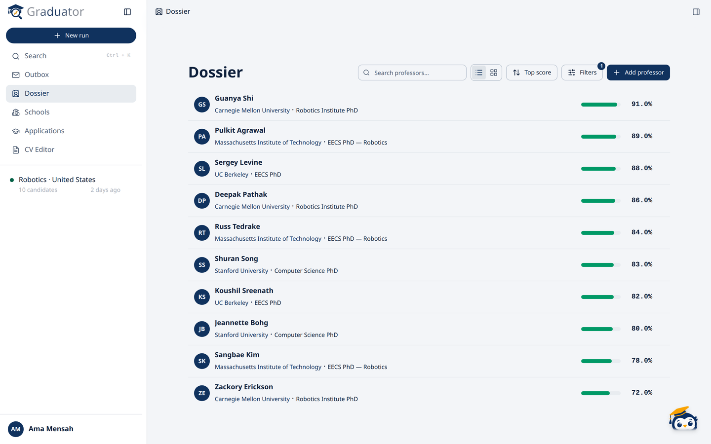
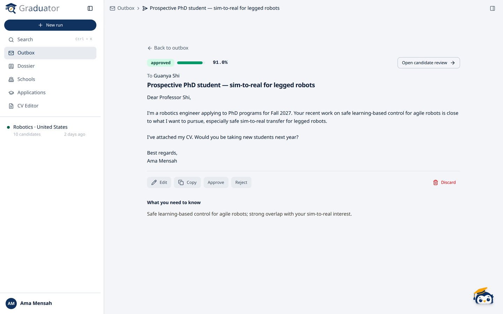
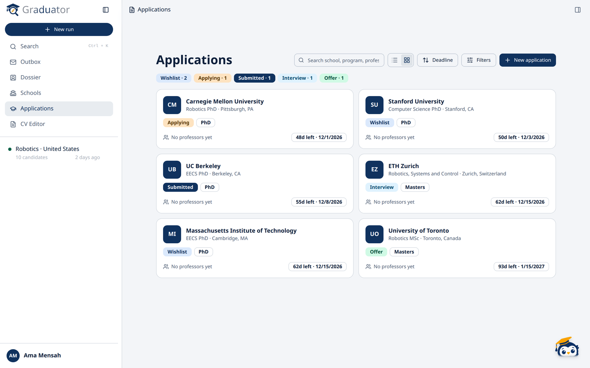

<p align="center">
  
</p>

<h1 align="center">Graduator</h1>

<p align="center">
  Find the right graduate programmes and supervisors, then reach out with confidence.
</p>

Graduator is a research assistant for graduate school applications. You describe what you want to study. Its agents then:

1. find programmes that match,
2. identify their faculty,
3. read each professor's actual publication record,
4. score how well each professor fits your interests, and
5. draft a personal outreach email for you to review.

**Nothing is ever sent for you.** Every draft waits in your Outbox until you approve it, copy it, and send it yourself.



## Features

- **Discovery runs.** Start from a region and field, or from your own list of programmes. You can pull interests from your uploaded CV.
- **Dossier.** A ranked shortlist with each professor's papers, the reasons for the match, and an alignment score. Scores come from embeddings, not from an LLM's guess.
- **Outbox.** Draft, edit, approve or reject outreach emails.
- **Applications.** Track deadlines, requirements and status, from wishlist to offer.
- **CV curator.** Upload your CV once; tailor it for each professor with Gradis, accepting or rejecting each suggested change, then copy it as text or download a PDF.
- **Gradis.** A built-in assistant that can look up your runs, professors, applications and drafts.
- **Flows.** Copy the research pipeline, then switch steps off, narrow each step's tools, or add your own instructions.
- **Bring your own model.** Works with Anthropic, OpenAI, Gemini, Ollama, or any OpenAI-compatible server. Each account can set its own model and key.
- **Your account, your data.** Sign in with email or Google, export everything as one ZIP, and track your model usage.

| Outbox | Applications |
|---|---|
|  |  |

## How it works


Graduator has two processes that share one Postgres database:

- **API** (FastAPI): serves the web app and adds agent work to a queue.
- **Worker**: picks up queued tasks and runs the agent loop.

The agent decides what to look at next. The tools it calls are deterministic: publication data comes from [OpenAlex](https://openalex.org), and every write goes through a fixed schema. That means the agent can only report what a tool actually returned.

Budgets cap how much work each task and run can do. Progress is saved after every turn, so a crashed worker picks up where it left off.

See [docs/architecture.md](docs/architecture.md) for the full design.

```
api/        FastAPI app, agent worker, migrations, tests
webapp/     React + TypeScript dashboard (Vite, Tailwind)
website/    Marketing site (Astro, static build)
docs/       Architecture, reference, deployment and data handling
```

## Quick start

You need Docker, [uv](https://docs.astral.sh/uv/) and Node 22.

```bash
make install                      # backend and frontend dependencies
cp api/.env.example api/.env      # add your model key (see below)

make db                           # Postgres in Docker
make api                          # API on http://localhost:8000
make worker                       # agent worker (second terminal)
make web                          # web app on http://localhost:5173 (third terminal)
```

Database migrations run automatically when the API starts. Run `make help` to see every command.

### Keys

Set these in `api/.env`:

| Variable | Needed for |
|---|---|
| `LLM_PROVIDER`, `LLM_API_KEY` | The agent. Use `ollama` to run locally with no key. |
| `TAVILY_API_KEY` or `BRAVE_API_KEY` | Programme and faculty search. Without either, discovery works only from URLs the agent already knows (keyless DuckDuckGo is opt-in via `SEARCH_PROVIDERS`). |
| `EMBEDDING_PROVIDER`, `EMBEDDING_API_KEY` | Fit scores. Without a key, scoring falls back to keyword overlap. |
| `AUTH_SECRET` | Signs sign-in tokens. Required in production. |

Every other setting is listed, with its default, in [`api/.env.example`](api/.env.example).

## Development


```bash
make verify       # lint, backend tests and type-checked web build in one go
make test         # backend suite on a scratch database (never touches your dev data)
make revision MSG="describe the change"   # create a migration from model changes
```

Run `make lint` before opening a PR. CI runs the same checks.

## Deployment

The API and the worker share one Docker image; the web app is a static build served by nginx. The marketing site (`website/`) is a separate static build deployed to GitHub Pages. To run the full stack locally:

```bash
make up           # web app on :8080, API on :8000
make site         # marketing site on :4321
```

To deploy the apps separately, scale workers, or set up cross-origin hosting, see [docs/deployment.md](docs/deployment.md). Before going live, work through the [production checklist](docs/production-checklist.md).

```bash
make backup           # dump Postgres to ./backups
make backup-verify    # restore the newest dump into a scratch database and check it
make encrypt-secrets  # one-off: encrypt provider keys stored by older versions
```

## Documentation

| Doc | What's inside |
|---|---|
| [Architecture](docs/architecture.md) | Design decisions, how a run flows, budgets, crash recovery, observability |
| [Deployment](docs/deployment.md) | Docker images, hosting topologies, migrations |
| [Production checklist](docs/production-checklist.md) | What's been hardened before launch |
| [Production readiness review](docs/production-readiness-review.md) · [Architecture upgrades](docs/architecture-upgrades.md) | Open production and scaling work, and a proposal for it |
| [Backups](docs/backups.md) | What's backed up, scheduling, restore drills |
| [Email](docs/email.md) · [Sign-in providers](docs/sign-in-providers.md) | SMTP setup; Google OAuth client setup |
| [Notifications](docs/notifications.md) | Inbox, browser push (VAPID keys) and email notifications; deadline reminders |
| [Plans](docs/plans.md) · [Flows](docs/flows.md) · [Fallbacks](docs/fallbacks.md) · [Verification sources](docs/verification-sources.md) | Paywalls, custom pipelines, external-service fallbacks, sources beyond OpenAlex |
| [CV sandbox](docs/cv-sandbox.md) | How uploaded documents are isolated |
| [Data handling](docs/data-handling.md) | What is sent to LLM providers, and what is stored |

See [CHANGELOG.md](CHANGELOG.md) for what changed in each release.
