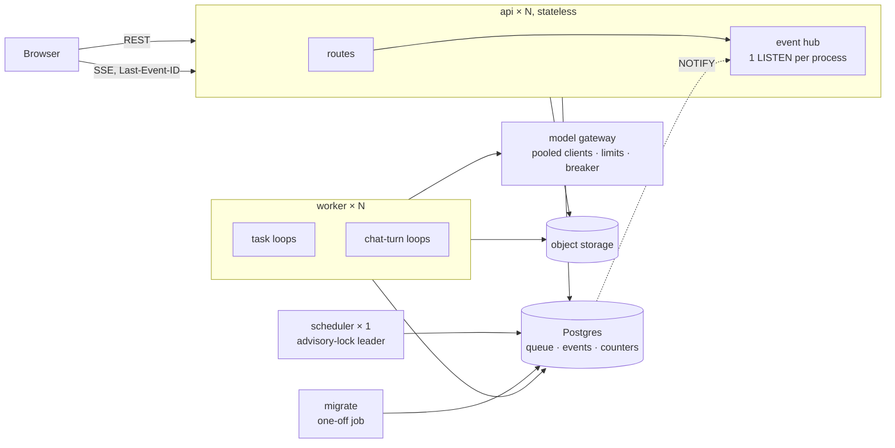

# Architecture upgrades

A proposal, 2026-10-26. It follows the [production readiness review](production-readiness-review.md); the N- and F- numbers below refer to findings there.

Most of that review's findings come from three design decisions:

1. A Gradis turn is tied to the HTTP request that started it.
2. Each task's live trace and checkpoint are JSON text columns, rewritten in full on every step.
3. Throttles, the one-turn-per-chat guard and the stream cap live in process memory.

This document proposes five upgrades that change those decisions, plus two supporting ones. It also deliberately does **not** propose a message broker, Redis, Kubernetes or splitting into separate services. Postgres already provides the queue (`SKIP LOCKED`, leases), wake-ups (`LISTEN/NOTIFY`) and locks (advisory locks), and it will carry this product's load for a long time. Each new piece of infrastructure has to justify itself against that.

## Target shape



- **api:** answers requests and streams events. It holds no state that matters across processes, so any number of copies can run.
- **worker:** runs everything that calls a model, meaning research tasks and Gradis turns.
- **scheduler:** a single process for periodic housekeeping.
- **migrate:** a one-off job that runs migrations before anything else starts.

---

## U1 · Event log: one append-only table for run and chat activity

**Fixes:** N4 (write amplification), the feed's whole-trace re-parse, gaps after a stream reconnects, and part of F13.

### Schema

```sql
CREATE TABLE events (
    stream_id  text        NOT NULL,  -- 'task:<id>' or 'turn:<id>'
    seq        bigint      NOT NULL,  -- 1, 2, 3 ... within the stream
    user_id    text        NOT NULL REFERENCES users(id) ON DELETE CASCADE,
    scope_id   text        NOT NULL,  -- run_id or conversation_id, for fan-out
    kind       text        NOT NULL,  -- turn | tool | text | status | confirm | done | error
    payload    jsonb       NOT NULL,
    at         timestamptz NOT NULL DEFAULT now(),
    PRIMARY KEY (stream_id, seq)
);
CREATE INDEX events_scope_at ON events (scope_id, at);
```

How it works:

- **Writing:** each writer allocates the next `seq` while it holds its lease. A task's writer is the worker that owns its lease; a turn's writer is the worker that owns the turn (see U2). Nothing else writes to a stream, so the counter can live in memory and resume from `max(seq)`. The primary key turns any accidental double write into an error rather than silent corruption. Each insert sends `pg_notify('graduator_events', '<scope_id>:<stream_id>:<seq>')` in the same transaction.
- **Full tool payloads** stay in `tool_call_logs`. The event's payload carries the preview and the `tool_call_logs.id`, as `task.log` entries do today.
- **Checkpoints:** a task's checkpoint becomes the messages added since its last checkpoint, stored as a `checkpoint` event, instead of the full `messages_json` every turn. Resuming replays them in order. A full snapshot is written every K turns, so replays stay short.
- **Retention:** the cleanup that today nulls `task.log` and `messages_json` becomes `DELETE FROM events WHERE at < cutoff`, run in batches. If volume needs it, monthly partitions turn that into dropping a partition.

### Reading

A stream sends `events WHERE stream_id = ANY(...) AND seq > last_sent`. The browser's `Last-Event-ID` (`<stream_id>:<seq>`) restores `last_sent` on reconnect. On the frontend, the existing `applyTraceEvent` and `TraceDelta` `from`/`total` logic keep working; they just get exact positions.

### Migration path

1. Write events alongside `task.log` (dual write). The feed reads from `events` when a task has any, and from `log` otherwise.
2. Backfill is not needed. The existing traces are bounded by `trace_retention_days` and age out.
3. Stop writing `task.log` and `messages_json` after one retention period. Drop the columns.

---

## U2 · Gradis turns run as jobs, not inside the request

**Fixes:** N1 (connection held across the model call, and the leak warning), N5's one-turn race, turns lost when a tab closes, and turns cut off by a deploy.

### Today

`POST /assistant/conversations/{id}/chat` opens a session, runs the whole model loop inside the response generator, and yields SSE from inside that session. When the client disconnects, the turn is cancelled.

### Proposed

1. **The route** checks the request as now (feature, quota, outstanding confirmation). It then claims the conversation in one statement:

   ```sql
   UPDATE assistant_conversations
      SET turn_id = :new_turn, turn_claimed_by = NULL, turn_started_at = now()
    WHERE id = :id AND user_id = :uid
      AND (turn_id IS NULL OR turn_heartbeat_at < now() - interval '2 minutes')
   RETURNING id;
   ```

   No row back means a turn is already running, so the route returns `409`. Two simultaneous requests cannot both pass, because the claim is atomic in the database. The route then writes the user's message, sends `NOTIFY ... 'work'`, and returns `202 {turn_id}`.
2. **A chat-turn loop in the worker** claims pending turns the same way it claims tasks: `SKIP LOCKED`, lease, heartbeat. It runs today's `_run_streaming_loop` with three changes:
   - Each step opens a short session and commits before every model call, as `agent/orchestrator.py` already does.
   - Output goes to the event log as `kind=text` chunks, buffered for about 75 ms or 200 characters, so typing still looks smooth without one write per token.
   - Confirmation pauses become a `confirm` event plus `turn_id` cleared, the same state `pending_call_json` holds today.
3. **The browser** opens `GET /assistant/turns/{turn_id}/events` (SSE through the hub, U3). On reload, it reattaches to the running turn instead of losing it.
4. **Urgent prompts** go into the existing `AssistantQueueItem` table, as they do now. The turn loop already reads them at each turn boundary.

### What it costs

- **Latency:** one `NOTIFY` hop, a few milliseconds, plus the chunk buffer. That's well under what a user can notice next to model time-to-first-token.
- **Capacity:** chat turns now share worker capacity with research tasks. Give them their own loop pool (`--chat-concurrency`) so a large run can't starve chat. Draft emails already get priority in the claim query; chat needs the same.
- **Frontend:** `GradisProvider`'s stream handling changes from "POST and read the body" to "POST, then subscribe". This is the largest piece of the frontend work. The event shapes can stay as they are.

### Interim fix

Until U2 ships, commit before every `chat_stream` call and stop yielding inside the session (N1). That's an afternoon's work and removes the outage risk.

---

## U3 · An event hub per API process

**Fixes:** N2 (one Postgres connection per open stream, and the hang at stream 33).

- One `asyncpg` connection per process runs `LISTEN graduator_events`.
- The hub keeps `scope_id → set[asyncio.Queue]`. A notification payload names the scope, so only that scope's subscribers wake up.
- A subscriber reads its events from the event log (U1) in a short pooled session, then goes back to waiting. A slow subscriber gets coalesced wake-ups rather than a growing queue, since the next read takes everything after its `seq` anyway.
- If the `LISTEN` connection drops, the hub reconnects and wakes every subscriber once, and each catches up from its `seq`. The sweep becomes this reconnect path, not a timer for each stream.
- **The limit** becomes memory: thousands of streams per process. Keep a soft cap, and above it return `503` with `Retry-After` straight away.
- **Auth** moves to a short-lived stream ticket. `POST /streams/ticket` returns an opaque 60-second token bound to the user and scope, and that token goes in the URL in place of the access token (F08).

---

## U4 · Shared state in Postgres; a stateless API

**Fixes:** N5 (throttles and lockout multiplied by the number of processes, and unbounded memory).

```sql
CREATE UNLOGGED TABLE rate_hits (
    bucket text NOT NULL, key text NOT NULL, window_start timestamptz NOT NULL,
    hits int NOT NULL DEFAULT 0,
    PRIMARY KEY (bucket, key, window_start)
);
```

- **Rate limits** become fixed windows with one upsert per check: `INSERT ... ON CONFLICT DO UPDATE SET hits = hits + 1 RETURNING hits`. They are slightly less smooth than today's sliding windows, and that's fine for throttles. The table is `UNLOGGED` because losing counters in a crash is acceptable. The scheduler deletes expired windows.
- **The login lockout** uses the same table, with bucket `login`.
- **The one-turn guard** is now the claim in U2.
- `RateLimiter.hit` stays the seam, so routes don't change.
- **Redis** is worth adding only when this table shows up in database load, which at one upsert per throttled request is unlikely before tens of requests per second.

Also include the uvicorn proxy-headers fix (N6). Once the API is stateless, you can run uvicorn with `--workers` or more replicas freely.

---

## U5 · Processes split by role

**Fixes:** N7 (housekeeping in every worker, duplicate digests) and N8 (migrations racing and out of order).

| Process | Runs | How many |
|---|---|---|
| `migrate` | `alembic upgrade head` under `pg_advisory_lock`, then exits | One-off, before every deploy |
| `api` | Routes and the event hub | Any number |
| `worker` | Task loops and chat-turn loops (`--concurrency`, `--chat-concurrency`) | Any number |
| `scheduler` | Reaper, heartbeat pruning, retention, deadline reminders, digests, export sweep, rate-window cleanup | One. A second copy waits on `pg_try_advisory_lock` and takes over if the first dies |

- **Compose:** `api` and `worker` both have `depends_on: migrate: condition: service_completed_successfully`. The worker also checks the database's Alembic revision at startup and refuses to start against a schema it doesn't recognise.
- **Digests:** the scheduler claims each user's digest before sending it (`UPDATE ... SET last_digest_on = :day WHERE last_digest_on IS DISTINCT FROM :day RETURNING`), commits, and then sends. A failed send is retried from a small outbox table, not by rerunning the whole batch.
- **Reaping** stays fast because nothing slow shares its loop.

---

## Supporting upgrades

### S1 · A model gateway

Today `get_provider()` creates a new SDK client per task or turn and never closes it (N9). Provider error handling is spread out, which is why the 400 from Anthropic needed work.

Proposed: one module behind `BaseLLMProvider` that provides:

- **Client pool:** one SDK client per (provider, base URL, key hash), reused and closed on shutdown.
- **Limits:** concurrency limits per provider and per key, generalising `ollama_max_concurrency`.
- **Errors:** timeouts, retries and error classification in one place. The fixed user-facing hints in `core/egress.py` move here, so the worker and Gradis say the same things.
- **Circuit breaker:** after repeated provider failures (`5xx`, out of credit, invalid key), stop claiming that provider's work, and pause affected runs with a clear reason. Today each task fails on its own.

### S2 · Object storage and observability

- **Storage (N12):** a `Storage` interface with `put/get/delete/presign`, using S3-compatible storage in production and the local disk in development. Database rows hold object keys. Deletes use a durable outbox, which also fixes F11. Once this is in, the API and worker no longer have to share a disk or a host.
- **Observability (N13):** `logging` configured once, as JSON. OpenTelemetry tracing across api → worker → model call, linked by `run_id`, `task_id` and `turn_id`. Metrics for queue depth by type, claim latency, pool checkouts in use, open streams, and model latency and errors per provider. Sentry for exceptions. Do this **before** U1–U3 so their effect can be measured.

---

## Order and effort

| Step | Depends on | Size | User-visible? |
|---|---|---|---|
| Interim N1 fix, N6 proxy headers, N3 timeouts | — | Days | No; it removes outage risks |
| S2 observability | — | About 1 week | No |
| U1 event log (dual write) | — | 1–2 weeks | No |
| U3 event hub + stream tickets | U1 | About 1 week | Live views get more reliable |
| U5 process split + migrate job | — | Days | No |
| U4 shared state | — | Days | No |
| U2 turn jobs | U1, U3 | 2–3 weeks, about half of it frontend | Chats survive reloads and deploys |
| S1 model gateway | — | About 1 week | Clearer provider failures |
| S2 object storage | — | About 1 week | No |
| Drop `task.log` and `messages_json` | U1 + one retention period | Hours | No |

U1, U4 and U5 don't depend on each other and can be built in parallel. U2 is the only step that needs coordinated frontend work. Each step ships on its own and leaves the system working.

## What stays as it is

- **The Postgres queue:** `SKIP LOCKED` claims, leases and fencing, and heartbeat reaping are sound. N10 (claim cost) is an index and query fix, not a reason for a broker. Measure it first.
- **The spend reservations** in `billing/service.py`: already shared across processes and safe under concurrency.
- **The feature module layout** (`api/<feature>/`): the new pieces fit into it. The event log goes in `core/events.py`, the hub in `core/hub.py`, the gateway in `agent/llm/gateway.py`, the scheduler in `api/scheduler.py`.
