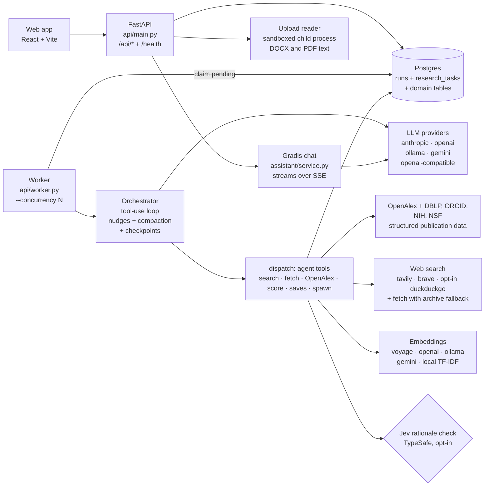
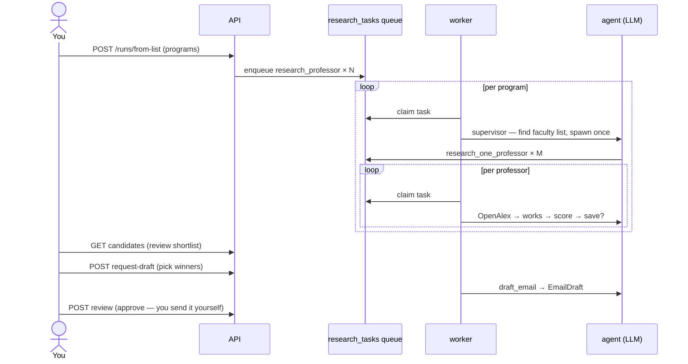
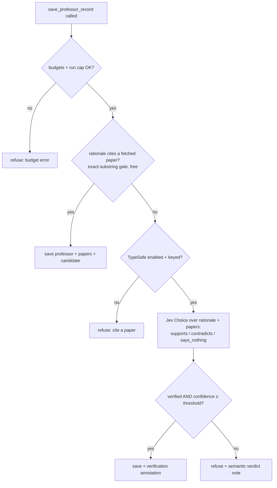

# Architecture

How Graduator's API, worker and agent fit together, and why they are built this way.

## Overview



Two processes share one database. The API serves the web app, writes `runs` and enqueues `research_tasks`; the worker claims tasks, runs the agent loop, and writes results back. Every cross-process handoff is a DB row, so either process can crash and resume. Writes also emit Postgres `NOTIFY` events (`runs/notify.py`), which wake idle workers and push live updates to the web app without polling.

### Module map

Each feature owns its models, schemas, routes, services, agent tools, task handlers and prompts. The shared kernel (config, DB, rate limits) lives in `api/core/`; the agent loop lives in `api/agent/`.

| Path | Role |
|---|---|
| `api/api/main.py` | FastAPI app: `/health`, `/ready`, and every feature router under `/api` |
| `api/api/worker.py` | Worker CLI entry (`python -m api.worker`) |
| `api/api/core/` | `config.py` (every env setting), `db.py` (engine, sessions, Alembic upgrade on boot), `ratelimit.py` (per-account throttles), `exceptions.py`, `ids.py`, `time.py` |
| `api/api/agent/orchestrator.py` | Provider-agnostic tool-use loop: nudges, compaction, checkpoints, parallel read-only calls |
| `api/api/agent/tools/` | `definitions.py` (tool schemas), `dispatch.py` (routes each call to its feature), `context.py` and `budgets.py` (per-task and per-run caps) |
| `api/api/agent/llm/` | Provider interface, Anthropic and OpenAI-compatible backends, and the factory that picks one |
| `api/api/auth/` | Accounts: registration, login, JWT access tokens, rotating refresh tokens, profile, `email_flows.py` (password reset, email verification), `oauth.py` (Google sign-in) |
| `api/api/account/` | Data export: one ZIP with everything an account owns, downloaded through a short-lived signed link |
| `api/api/billing/` | Plans (`plans.py`) and the single enforcement point (`service.py`) that returns `402` with an upgrade payload |
| `api/api/metering/` | Daily usage rollups per account, feature and model, with your own view and an ops view |
| `api/api/flows/` | Agent flows: the research pipeline as data, with user copies whose steps can be switched off, narrowed or given instructions |
| `api/api/runs/` | Runs and the queue: `queue.py` (claim, reaper, heartbeats, worker loops), `lifecycle.py` (pause, resume, cancel, done), `notify.py` (LISTEN/NOTIFY), `interests.py` (interest suggestions from a CV), `health.py`, routes for runs and tasks |
| `api/api/prospects/` | Schools, programmes, professors and papers: `web.py` (search providers in order, cached results, fetch with archive fallback), `openalex.py`, `tools.py` (saves, verification, dedup, spawn), `tasks.py` (discovery and research handlers), routes for each entity |
| `api/api/candidates/` | The review shortlist: `scoring.py` (embeddings + cosine similarity), `verification.py` (opt-in Jev check), review routes |
| `api/api/outreach/` | Email drafts, which are never sent: draft task handler, prompts, edit and review routes |
| `api/api/applications/` | Application tracker: status, deadlines (`dates.py` parses free text to a date), requirements, linked professors |
| `api/api/notifications/` | Inbox, browser push and email notifications: `events.py` (event sites), `delivery.py` (worker delivery: quiet hours, cap, push, email), `deadlines.py` (deadline reminders, digest); see [notifications.md](notifications.md) |
| `api/api/assistant/` | Gradis chat: conversations, streamed turns, read tools, and write tools that need your confirmation |
| `api/api/cv/` | CV curator: `engine.py` and `pdf_text.py` (read an uploaded DOCX or PDF), `sandbox.py` + `sandbox_worker.py` (run that reading in a locked-down child process), `markdown.py` (upload to Markdown, plain text, sections), `claims.py` (the no-new-facts check), `pdf_export.py` (simple PDF), base CVs, tailored versions and suggestions |
| `api/api/agents/` | Agent and tool registry, seeded from code: turn agents and tools on or off from Settings; also reports the external-service fallback order |
| `api/api/providers/` | Per-account model choice and API keys, set in Settings; environment config is the fallback |
| `api/alembic/` | Migrations, applied on boot (see [deployment.md](deployment.md#migrations)) |
| `api/tests/` | Backend suite, run against a scratch database (see `conftest.py`) |
| `webapp/src/` | React app: `pages/` (one per route), `components/` (grouped by feature, primitives in `ui/`), `lib/` (API client, queries, auth, live updates). Signed-out visitors are sent to the marketing site (`website/`, via `VITE_SITE_URL`) or to sign-in |

### Data model

Every row belongs to one account (`user_id`), and every query is scoped to the signed-in user.

| Table | One row per... |
|---|---|
| `users` / `auth_refresh_tokens` | Account (email, password hash, display name, avatar, plan) / active sign-in session |
| `auth_email_tokens` | One-time password-reset or email-verification link (stored hashed) |
| `user_identities` | Linked external sign-in (Google) |
| `account_exports` | Requested data export and its archive |
| `usage_daily` | One account's model calls and tokens for one day, feature, provider and model |
| `agent_flows` | Your custom copy of the research pipeline |
| `runs` | Run (region and field, or a preselected list, plus your interest statement and its cached embedding) |
| `research_tasks` | Unit of agent work plus its live trace (`log`, `final_text`, `turns`, tokens, checkpoint) |
| `tool_call_logs` | Queryable record of one tool call (full payloads) |
| `worker_heartbeats` | Running worker process |
| `notifications` / `push_subscriptions` / `notification_preferences` | Inbox entry (deduped per account) / browser that receives push / an account's channels, quiet hours and timezone |
| `schools` / `programs` | Discovered, preselected or hand-added institutions: one row per school per account, shared by every run that finds it |
| `run_schools` | Which runs use which school, with that run's origin (agent or person) and tier; per-run school caps count these |
| `professors` / `papers` | Researched faculty and their OpenAlex works |
| `professor_index` | A professor one of your runs looked up, match or not: their OpenAlex author, the works fetched, what that run concluded and when. Later runs reuse it instead of going online (see below) |
| `candidate_scores` | What you review: score, rationale and status |
| `email_drafts` | Draft waiting for your approval (never sent automatically) |
| `applications` | Application you're tracking |
| `assistant_conversations` / `assistant_messages` | Gradis chat thread / message |
| `cv_documents` / `cv_tailored_versions` / `cv_suggestions` | Base CV in Markdown (plus the uploaded file) / named copy tailored for a professor or application / suggested change waiting for review |
| `agent_tasks` / `agent_tools` | Agent setting per task type / tool and whether it's enabled |
| `provider_configs` | Model provider settings for an account (keys are never returned by the API) |

## Why this architecture

**Agent + narrow tools, not one big autonomous loop.** The agent (your chosen LLM, via a provider-agnostic tool-use loop in `api/agent/llm/`) decides *what to do next* — which faculty page to check, whether a name match on OpenAlex is the right person, how to phrase a rationale. The tools it calls are deliberately boring and deterministic: OpenAlex lookups return real API data, alignment scores come from cosine similarity over embeddings (never an LLM-estimated percentage), and every write to the database goes through a fixed schema. This is what keeps the system from hallucinating a plausible-sounding professor or paper that doesn't exist — the agent can only report what a tool actually returned. `save_professor_record` enforces that: the OpenAlex id, the stored papers and the stored score are taken from what `find_openalex_author`, `get_author_works` and `score_alignment` returned in the same task (`api/prospects/grounding.py`), and a save citing anything else is refused.

**Bring-your-own-model, not Claude-only.** The orchestrator talks to a small provider interface (`api/agent/llm/`: `anthropic_provider.py`, `openai_compat_provider.py`, `factory.py`), and tool schemas are defined once in neutral form (`TOOL_DEFINITIONS` in `api/agent/tools/definitions.py`) and translated per provider. `openai`, `ollama`, `gemini`, and any `openai-compatible` server all speak the `/v1/chat/completions` dialect through the `openai` package, so adding a model is config, not a code change. Each account can pick its provider, model and key under Settings → Models (`api/providers/`); the `LLM_PROVIDER`/`LLM_MODEL` environment settings are the fallback. Embeddings are pluggable the same way (`EMBEDDING_PROVIDER`).

**OpenAlex over scraping faculty pages for papers.** University sites are inconsistent enough that treating publication data as a scraping problem makes the whole pipeline fragile. OpenAlex gives structured author + publication data (set `OPENALEX_API_KEY` for a budget of your own; see [fallbacks.md](fallbacks.md)), with DBLP, ORCID and the NIH/NSF grant databases as further sources ([verification-sources.md](verification-sources.md)), so scraping is only used where there's genuinely no alternative: finding *who* is faculty in a department, since there's no universal API for that.

**External calls degrade, they don't crash.** Web search tries each configured provider in order (`SEARCH_PROVIDERS`; DuckDuckGo only when listed), then recent cached results. Page fetches fall back to the Internet Archive. OpenAlex calls retry on rate limits, and if they still fail the agent is told not to invent papers. See [fallbacks.md](fallbacks.md).

**A DB-backed task queue instead of Celery/Redis, for now.** The `research_tasks` table is deliberately low-tech — one less service to run locally, and you can inspect exactly what's pending/running/failed with a SQL query while you're debugging agent behavior. Workers already scale horizontally (`FOR UPDATE SKIP LOCKED` claims, leases, transient retries). Swap in Celery/RQ later if the queue outgrows Postgres; nothing in `orchestrator.py` or the feature `tools.py` modules needs to change to do that.

**Sending email is out of scope on purpose.** `save_email_draft` is a terminal action. Approving a draft (`POST /candidates/{id}/review`) marks it reviewed, it does not send it. Two reasons: professors can tell a templated cold email from a personalized one, so you *want* a manual edit/send step; and a system that can autonomously decide a weak match is worth emailing anyway, then actually send it, is a much bigger blast radius for a bug than one that queues a draft.

## How a run flows



**Each account keeps an index of the professors its runs looked up** (#160, `api/prospects/professor_index.py`). A professor task records the one OpenAlex author it settled on at the school and the works it fetched, whether or not they matched, in `professor_index` (your account only, never shared). A later professor task checks it before going online: the same name at the same school (by school row or school name) reuses the author and works, and an author found by a search reuses their works, so the professor is scored against the new run's interests with no OpenAlex call. Entries older than `PROFESSOR_INDEX_DAYS` (default 30; 0 turns the index off) are skipped and replaced by the next lookup. Nothing is researched just for the index, people who opted out are never kept or reused, and an entry outlives the run, school or programme that found it (their ids are cleared, the names stay). The trace shows a reuse as a "From your index" step.

The account's schools can be filtered by the tier discovery placed them in (`GET /api/schools?tier=strong`, or `none`; the Tier filter on the Schools page). A school a person added takes the first tier a later discovery places it in.

Or start from region discovery (`POST /api/runs`), which inserts a `discover_programs` task ahead of the supervisor stage: the agent searches the web, verifies programs exist, and each `save_program` fans out one `research_professor` task.

Every run follows a **flow**: the pipeline above, stored as data. The built-in *Standard research* flow is read-only; a copy can switch steps off, narrow each step's tools, or add instructions. A flow can only narrow what the account already allows, never widen it. See [flows.md](flows.md).

Prefer the preselected path when you know your schools: `POST /api/runs/from-list` with explicit `programs`. This skips the least reliable stage (region discovery) and goes straight to faculty research.

## Watching the agent work

A `done` status alone tells you nothing, so every task keeps a trace. The worker prints each tool call as it happens:

```
[worker] claimed discover_programs 3f9a1c2b (run 7d4e8f1a)
[worker] [discover_programs 3f9a1c2b turn 1] search_web(query='robotics PhD programs California') -> ok: ...
[worker] [discover_programs 3f9a1c2b turn 2] save_program(school_name='...', ...) -> ok: ...
[worker] done discover_programs 3f9a1c2b in 4 turns: Saved 9 verified programs, skipped 3 unverifiable ones...
```

The same trace is persisted incrementally on the task row. The UI reads it
over the event feed rather than polling: `GET /api/runs/{id}/events` emits a
`trace` frame per batch of new tool calls while a task is open (`from: 0`
replaces the trace, a higher `from` appends that tail), so the journal fills
in as the agent works. `done` on that feed means the queue is empty, not
that the stream ended — a run's queue drains and refills routinely, and the
feed stays open so requeued work still pushes. You can also poll the task
row directly:

```bash
curl localhost:8000/api/runs/{run_id}/tasks
```

Each entry has `status`, `turns`, `error`, `final_text` (the agent's closing summary), and `log` — one event per tool call with `turn`, `tool`, `input`, a truncated `result_preview`, an `ok` flag, and the agent's short `note` for that turn. Previews are truncated by design; the full findings live in the domain tables (`schools`, `programs`, `professors`, `papers`, `candidate_scores`) that the tools wrote along the way.

## Budgets (anti-runaway guards)

Four layers keep a confused agent from searching forever:

- `MAX_AGENT_TURNS` (default 40) caps tool-call turns per task — the token
  backstop.
- Per-task entity budgets cap what one task may *create*:
  `MAX_PROGRAMS_PER_TASK` (12), `MAX_PROFESSORS_PER_TASK` (10), `MAX_DRAFTS_PER_TASK` (3). These matter because each `save_program` fans out a new `research_professor` task — unbounded discovery would explode the queue, not just burn tokens.
- Per-run convergence budgets bound total work so every run terminates:
  `MAX_PROGRAMS_PER_RUN` (10 schools), `MAX_PROFESSORS_PER_PROGRAM` (5 researched per program; a failed task doesn't count), `MAX_CANDIDATES_PER_RUN` (30 kept in total). Supervisors store every faculty name as a `deferred` lead; `api/prospects/leads.py` releases leads on each task conclusion so saved plus open stays under the candidate cap, each program gets a fair share, and a professor who doesn't match frees a slot for the next lead. `RESEARCH_BUDGET_FACTOR` (2.5) x the candidate cap bounds total narrow research. Each is overridable per run at creation (`max_programs`, `max_professors`, `max_professors_per_program` on `POST /api/runs` and `POST /api/runs/from-list`); unset means the global default. Enforced by live `COUNT` in `dispatch()` — no counter column to drift. Approximate under parallel workers (check-then-insert can overshoot by a row or two). Worst case per run is roughly `programs × (1 supervisor + N narrow)` tasks plus drafts.

Budgets are enforced deterministically in `dispatch()`, not just suggested in prompts (though the task briefs state them too, so the agent plans within them). Hitting one returns a tool error telling the agent to stop saving and write its final summary — which shows up in the task trace as an `ok: false` event.

There is also a floor, not just a ceiling: if the agent tries to finish a task without calling any of its progress tools (`save_program`, `spawn_professor_research`, `save_professor_record`, `save_email_draft` depending on task type), the orchestrator bounces it back with a nudge instead of accepting the empty finish — up to `MAX_EMPTY_FINISH_NUDGES` (2), then the summary stands. This is what stops a weak model from doing two searches, declaring victory, and leaving you with zero programs. Nudges are reported in the worker's `done` line and counted in the task result.

## Semantic verification (TypeSafe, opt-in)

The built-in rationale check is an exact-substring gate: free and precise, but it false-refuses legitimate paraphrase ("their work on RL planners" instead of the verbatim title). With `TYPESAFE_RATIONALE_CHECK=true` and a `TYPESAFE_API_KEY`, a refused rationale gets a second hearing from Jev (TypeSafe's System One model): one `Choice` judgment (supports/contradicts/says_nothing) over the rationale plus paper titles/abstracts, gated by `TYPESAFE_AUTO_ACCEPT` confidence (0.8). Only a verified + auto-accepted judgment overrides the refusal, and the verdict lands on the save result — anything else (including outages) keeps the refusal, so the feature fails closed. Exact citations never touch the network. See `api/candidates/verification.py`.



Two more Jev judgments, each behind its own flag and failing to the old behaviour:

- **Author pick** (`TYPESAFE_AUTHOR_PICK`): when OpenAlex has several same-name authors at the school, the first pass asks Jev which one is the professor (a `Choice` over each author's institutions and topics, against the programme). A confident pick continues the code-first pass; anything else hands the professor to the agent loop as before. This is the commonest reason a professor took the full loop.
- **Fit rating** (`TYPESAFE_FIT_RATING`): a five-level `Score` of how well the closest papers fit the interests, judged on meaning rather than shared words. In the run, it is asked only when the similarity lands in the "unrelated" band, and a confident rating of related or better sends the professor to a save instead of a no-match. Check match shows it beside the similarity.

Related cost controls: tool results older than `MAX_TOOL_RESULT_AGE_TURNS` (2) are compacted out of the provider's context window, `FETCH_MAX_CHARS` (3000) caps page payloads, your interest statement is embedded once per run (not once per professor), and per-task `input_tokens`/`output_tokens` land on the task row (see `/tasks`) so you can see where tokens go.

## Crash recovery

Workers claim the oldest `pending` task of a running run with `SELECT ... FOR UPDATE OF research_tasks SKIP LOCKED`, ordered by stage (drafts, then a run's first narrow task, then discovery and supervisors, then the narrow bulk) and, within a stage, the run with the fewest tasks running (`runs/queue.py`). A claim takes a lease and bumps `attempt`, the ORM version column, so a superseded attempt's writes fail.

The worker checkpoints the full agent message history after every turn. Kill it mid-run and the stale-task reaper (runs every 60s) requeues `running` rows whose claiming worker has stopped heartbeating as `pending`, and they resume from the checkpoint instead of starting over. A slow but live attempt is never requeued, and a task paused and resumed mid-attempt waits for that attempt to wind down, so one task never runs twice at once. Saving the same professor twice is deduplicated on `(program_id, openalex_id)` by a check before insert and a unique constraint.

## Observability

Beyond the per-task traces (`GET /api/runs/{id}/tasks`) and the review feeds, four endpoints cover fleet health and cost:

- `GET /health` (signed in; counts are the caller's own) — `status` (`ok`/`degraded`), `database` (reachable,
  dialect, round-trip latency, row counts), `queue` (depth by status, `stale_running`, `last_activity_at`), `workers` (alive/stale counts plus per-process rows), `no_workers`, provider info, and feature flags. `degraded` when the DB is unreachable, tasks are stuck, recent tasks failed, or work waits with no live worker.
- `GET /ready` — 200 when the DB answers, else 503.
- `GET /api/workers` — one row per worker process (`worker_id`,
  `concurrency`, `started_at`, `last_seen_at`, `lag_seconds`, `alive`). Workers beat every `WORKER_HEARTBEAT_SECONDS` (15s); stale past 4× that means the process is gone. Rows older than a day are pruned.
- `GET /api/runs/{id}/usage` — summed `input_tokens`/`output_tokens`,
  `turns`, task counts by status, and per-tool call/error counts: where the tokens went.

## Accounts, plans and limits

- **Auth.** Passwords are hashed with bcrypt. Short-lived JWT access tokens are signed with `AUTH_SECRET`, and opaque refresh tokens rotate on every use. Repeated failed logins are throttled. Set `AUTH_SECRET` in production; otherwise every restart signs everyone out.
- **Email and Google sign-in.** Password-reset and verification links are single-use and stored hashed, and are sent over SMTP ([email.md](email.md)). Google sign-in uses OAuth with PKCE. If the Google email matches an existing account, the two are linked only after you confirm with that account's password, so one person never ends up with two accounts ([sign-in-providers.md](sign-in-providers.md)). Sensitive actions, such as data export, need a verified email.
- **Secrets at rest.** Model provider API keys are encrypted in the database with `SECRETS_KEY`, which defaults to a key derived from `AUTH_SECRET`; with neither set they are stored in plaintext. Run `make encrypt-secrets` once to encrypt keys stored by older versions.
- **Plans** (`billing/`). Each feature and quota is checked in one place, which returns `402` with a payload the web app shows as an upgrade prompt. While `BILLING_ENFORCED=false` (the default), every account is on the Beta plan: all features, no limits. See [plans.md](plans.md).
- **Metering** (`metering/`). Each model call adds its calls and tokens to a daily rollup, so storage stays bounded. Rows older than `USAGE_RETENTION_DAYS` are pruned. Accounts listed in `OPS_ADMIN_EMAILS` can see usage across all accounts once their email is verified.
- **Rate limits** (`core/ratelimit.py`). Uploads, chat turns, CV suggestions and agent work have per-account burst and hourly windows. Going over returns `429` with `Retry-After`. Limits live in process memory, which is correct for a single API process.
- **Run quotas** (the `metered` flag on `ToolContext`, `agent/tools/context.py`). Only saves made by the research agent count against a run's caps. Read-only lookups (search, fetch, OpenAlex, scoring, reading your own data) are free, so Gradis keeps working after a run's allowance is spent. Saves a person approves in chat have their own per-run cap.

## Gradis and the CV curator

**Gradis** (`assistant/`) is a chat assistant with its own short tool-use loop. It has no checkpoints or nudges: a turn either answers or proposes an action. Read tools run straight away. Write tools (saving a programme, an application, and so on) pause with a confirmation card, and run only when you accept it. Replies stream over SSE. A chat is offered the read tools first (lookups, search, web and OpenAlex research, scoring, CV reads and CV suggestions); the write tools join once you ask for a change, or the model calls `enable_changes`, and stay for the rest of that chat. The phase is read off the stored history, so it survives confirmation pauses and later messages (#211).

**The CV curator** (`cv/`) holds the facts of your CV and helps tailor them; styling stays in your own word processor. An upload (DOCX, PDF, Markdown or text) is read once into your base CV in Markdown, and the file is kept for download. A tailored version is a named copy for one professor or application. Gradis reads it and the professor's dossier, then suggests changes as find-and-replace pairs; each is checked for words your base CV never mentions, and nothing changes until you accept it (as suggested or edited). Every save carries the text's revision, so an edit made on stale text is refused rather than lost. Versions export as Markdown, plain text or a simple PDF.

**The document pages** (`webapp/src/components/documents/`, #210, #225; first built for CVs, now every kind). `/documents` (old `/cv` links redirect) lists each base CV with its saved tailored variants nested under it (plus unsaved ones on this device): open, rename, download, delete, upload, tailor for a professor. `/documents/:documentId` (`?version=<id>` for a saved variant, `?draft=<id>` for an unsaved one) is a Google-Docs-like editor: a Docs-style header (`DocumentHeader.tsx`: the kind's icon, which turns into the way back to the list; the editable name, folder and sync state; a File/Edit/View/Insert/Format/Tools menu bar; Tailor for…), a toolbar (undo/redo, paragraph style Normal/Title/Heading 1-3, bold, italic, underline, link, lists, tables, horizontal lines, outline, page breaks, suggestions) and the document as a page on a neutral canvas. Toolbar actions write Markdown (`editor/format.ts`); the stored format stays Markdown. Tables are GFM pipe tables (`editor/tables.ts`): shown as tables away from the cursor, edited as lined-up text in it (Tab/Shift-Tab between cells, Enter adds a row), and drawn by the PDF and Word exports (`api/cv/tables.py`).

- *Sync* (`useDocumentSync.ts`, `documentLocal.ts`): every edit goes to localStorage first (per account, per CV or variant, with the revision it started from) and to the server only when typing pauses for 5 seconds, when the editor loses focus or the tab is hidden or closed, on Ctrl/Cmd+S, and before a PDF export or accepting a suggestion. Offline, the copy stays on the device and syncs when the connection returns. A 409 keeps the local text and offers "Keep mine" or "Load the saved version"; a newer revision with the same text (a rename elsewhere) syncs over silently. On open, a device copy the server never got is restored and synced (or, if the server's text changed meanwhile, shown as a conflict).
- *Unsaved variants*: "Tailor for <professor>" (the editor, the list, and "Tailor my CV" in the outbox and dossier, via `?for=<candidate>`) opens the variant already saved for that professor, else a draft started from the base CV that exists only on this device until "Save variant" (`POST /cv/documents/{id}/versions` with `markdown` and `new`). Leaving one asks to save, keep as a draft or discard; closing the tab warns. Gradis works on saved CVs only: on a draft, asking Gradis shows "Save this variant to get suggestions", and the chat gets no CV context until it is saved.
- *Suggestions panel*: two tabs. Review lists the suggestions waiting, each shown as a change marked in place (`wordDiff.ts`) or, for a heavy rewrite, before and after; apply (as is or edited) or dismiss. Chat is Gradis itself (`GradisChat` with `variant="embedded"`): the same chats, tools, modes and models as everywhere else, with the open document as context; the changes it suggests appear under Review as they arrive. In the editor the floating and docked Gradis stand down, so there is one chat on screen. "Ask in chat" on the selection bar adds the selected passage to Gradis's context.

The API process never parses an uploaded document itself. Every DOCX and PDF is read in a short-lived child process with no secrets, CPU, memory and time limits, and no network where the kernel allows it. Malformed or malicious files are rejected with a specific reason. See [cv-sandbox.md](cv-sandbox.md).

See [data-handling.md](data-handling.md) for what is sent to model providers, and [backups.md](backups.md) for backups and restores.
