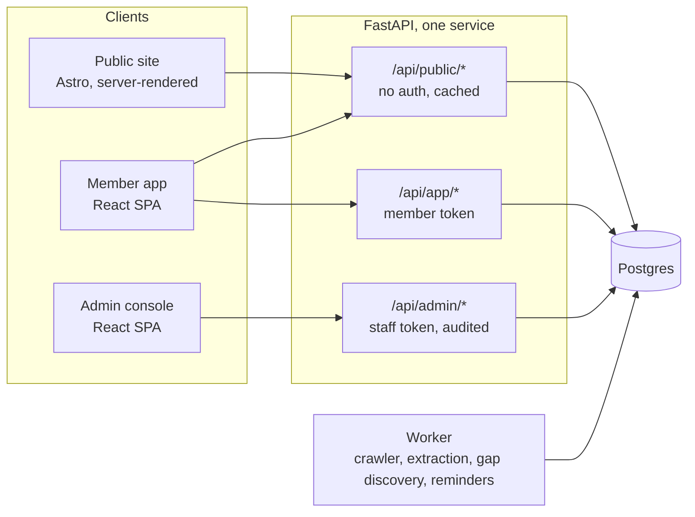

# Architecture

Blesser is three products on one backend:

| Surface | Who | Job | Host (placeholder) |
|---|---|---|---|
| **Public site** | Anyone, search engines | Show the opportunities the team has published. Invite people to sign up. | `blesser.org` |
| **Member app** | Signed-up members | Discover more (including member-only finds), track applications, plan to-dos, sync calendars, run scans. | `app.blesser.org` |
| **Admin console** | Staff (editors, admins) | Decide what the public site and the member app show. Review agent and community finds, edit, publish, feature, hide. Manage people and scans. | `admin.blesser.org` |

All three talk to the same FastAPI service and Postgres database. The worker crawls registered sources, triages and extracts candidate pages, then runs discovery agents for gaps. The admin console is the only place that changes what is public.



## Principles

1. **One source of truth.** Opportunities live in one table. Surfaces differ by what they are allowed to read, never by having their own copy.
2. **Publishing is an editorial act.** Nothing reaches the public site unless a staff member published it, or a rule they set publishes it.
3. **The API enforces visibility, not the client.** Each router group has its own response schemas. The public schema cannot leak internal fields, because it does not have them.
4. **Staff power is narrow and logged.** Every admin write records who, what, when, and the before and after values.
5. **One design system.** All three surfaces build from the same tokens and components (the Blesser design system), at different densities.

## Content model

### Who sees an opportunity

Two fields decide this: `status` (where it is in the editorial flow) and `audience` (who may see it once published).

| `status` | `audience` | Public site | Member app | Admin |
|---|---|---|---|---|
| `draft` | any | no | no | yes |
| `in_review` | any | no | no | yes (review queue) |
| `published` | `public` | yes | yes | yes |
| `published` | `members` | no | yes, marked "Members only" | yes |
| `archived` | any | no (old links show "This opportunity has closed") | in people's tracked applications only | yes |
| `hidden` | any | no (404) | no; tracked copies stay in applications | yes |

Defaults, all changeable in admin settings:

- **Agent finds** arrive as `published` + `members`. Members see new finds first; an editor promotes them to `public` after checking them. This makes discovery a reason to sign up and keeps the public site edited.
- **Community submissions** arrive as `in_review`.
- **Closed opportunities** move to `archived` automatically the day after their deadline unless they are `rolling`.

This replaces today's `pending | published | hidden` and the `OPPORTUNITY_AUTO_PUBLISH` flag.

### Schema changes

`opportunities` gains:

| Column | Purpose |
|---|---|
| `audience` | `public` or `members`. |
| `slug` | Stable, readable URL for the public site: `/opportunities/climate-venture-grant-cohort-6`. Unique; old slugs redirect. |
| `published_at`, `published_by` | When and by whom it went live. |
| `featured_rank` | Non-null puts it in the homepage "Featured" row, in this order. |
| `editor_note` | Internal note for staff. Never in public or member schemas. |
| `review_reason` | Why it is in review: `new_submission`, `agent_low_confidence`, `reported`, `source_changed`, `no_official_link`. |

New tables:

| Table | Purpose |
|---|---|
| `users.role` (column) | `member`, `editor`, `admin`. Replaces `OPS_ADMIN_EMAILS`; that variable stays only to seed the first admin on boot. |
| `collections`, `collection_items` | Curated lists the site shows: "Closing this month", "For students", "Climate and agriculture". Each has a slug, title, intro, `audience`, and either hand-picked items or a saved filter. |
| `site_content` | Keyed blocks the public site renders: hero headline and sub, announcement banner (text, link, start and end dates), footer links. Versioned rows; the site reads the latest published version. |
| `opportunity_reports` | "Something's wrong with this listing" from members and visitors. Opens a review item. |
| `audit_log` | `actor_id`, `action`, `entity_type`, `entity_id`, `before` and `after` JSON, `at`, `ip`. Append-only; no update or delete route. |

## API

One FastAPI service, three router groups. Each group has its own dependency that authenticates the caller and its own Pydantic response schemas.

### `/api/public/*`: no account

Read-only. Only `status = published` and `audience = public`. Responses carry `Cache-Control: public, s-maxage=300, stale-while-revalidate=3600` so a CDN or nginx cache absorbs traffic.

| Route | Returns |
|---|---|
| `GET /opportunities` | Filtered, paginated list (today's filters: `q`, `category`, `kind`, `country`, `closing_within`, `sort`). |
| `GET /opportunities/{slug}` | One opportunity. Archived ones return a closed marker; hidden ones 404. |
| `GET /opportunities/{slug}/calendar.ics` | The deadline as an event. |
| `GET /facets` | Counts per category and kind. |
| `GET /collections`, `GET /collections/{slug}` | Public collections and their items. |
| `GET /site` | Homepage blocks, featured opportunities, the active announcement. |
| `POST /submissions` | Share an opportunity (rate-limited, CAPTCHA). Lands `in_review`. |
| `POST /opportunities/{slug}/report` | Report a problem. |

The public schema has no `source`, `scan_id`, `created_by`, `editor_note`, `review_reason` or agent trace.

### `/api/app/*`: members

Everything in the member app: the member catalogue (published, either audience), tracking, applications, to-dos, calendar feed, scans, notifications, settings. These are today's `/api/*` routes, moved under the prefix. The member schema adds `audience` and `found_by` ("Found by the discovery agent, 3 days ago") so members can see what is new and members-only.

### `/api/admin/*`: staff

Requires a staff token (below). Every write goes through one `audited()` helper that writes `audit_log` in the same transaction.

| Area | Routes |
|---|---|
| Review queue | List `in_review` and newly found items with the agent's source excerpt and checks; approve (choose audience), edit then approve, reject with reason. |
| Opportunities | Full CRUD on every field, status and audience changes, bulk publish/archive/hide, merge duplicates, re-verify (queues a single-opportunity agent check). |
| Curation | Featured order, collections, homepage blocks, announcement banner, with preview links. |
| Scans and agent | Start scans for any category, see all scans and their traces, set the sweep schedule, set member scan quotas, set the publishing defaults above. |
| People | List and search accounts, change roles (admin only), disable an account, see a member's scan usage. No access to members' applications, notes or to-dos. |
| Audit | Read and filter the audit log (admin only). |

Roles: **editor** can do everything in Review, Opportunities, Curation and Scans. **Admin** also manages People, settings and the audit log.

## Authentication across three hosts

Today the member app uses a short JWT access token and a refresh token. Extend it rather than add a second system:

- Tokens carry an `aud` claim: `app` or `admin`. `/api/app/*` accepts `app`; `/api/admin/*` accepts only `admin`.
- The admin console signs in at `POST /api/admin/auth/login`. It issues an `admin` token only if the account's role is `editor` or `admin` and the email is verified. Admin refresh tokens last 12 hours instead of the member default, and the cookie is scoped to the admin host.
- A staff member who also uses the member app signs in there separately. An `app` token never opens admin routes.
- Phase 2: TOTP for staff accounts, required for `admin`.
- Each host proxies `/api` to the API service (as nginx does today), so every surface is same-origin and needs no CORS.

## Front ends

### Public site (`site/`)

- **Astro** with the Node adapter, server-rendered with short caching. Opportunities change daily from agent finds and edits, so on-request rendering with a 5-minute cache beats rebuilding a static site on every publish. Pages ship as HTML with no client JavaScript except small islands (filters, the "Track" button).
- Pages: home (hero, featured, closing soon, collections), `/opportunities` with filters, `/opportunities/{slug}`, `/collections/{slug}`, category landing pages (`/grants`, `/scholarships`...), about, privacy, terms.
- SEO: real titles and descriptions per opportunity, `JobPosting`-style structured data where it fits (or `Event` for the deadline), `sitemap.xml` generated from the public API, canonical slugs, Open Graph images.
- "Track" on a public card sends signed-out visitors to `app.blesser.org/register?track={slug}`, which tracks it after sign-up.

### Member app (`webapp/`)

- Stays a Vite React SPA. The signed-out frame in `App.tsx` (`MaybeShell`) goes: browsing without an account moves to the public site, and `/` redirects signed-out visitors there.
- Opportunities shows the member catalogue: everything public plus members-only finds, with a "New" filter for the last 7 days.

### Admin console (`admin/`)

- A second Vite React SPA with the same stack as the member app (React, TanStack Query, React Router, Tailwind), so the team learns one toolset.
- Desktop-first, dense: tables with saved filters, a side-panel editor with a live preview of the public card and page, keyboard shortcuts for the review queue (approve, edit, reject, next).
- Optionally put the host behind Cloudflare Access or an IP allowlist as a second lock; the role check stays the real one.

### Shared design system (`design-system/`)

- `tokens.json` is the source, copied from the Blesser design system artifact. A small script generates `tokens.css` and the Tailwind `@theme` block.
- An npm workspace package (`@blesser/ui`) holds the tokens CSS, fonts and the React primitives (Button, Chip, Countdown, Field, OpportunityCard, ApplicationStatus, EmptyState). The member app and admin console import it; the public site imports the CSS and the few components it renders as Astro islands.

## Repository layout

```
api/            FastAPI app and worker (routers split into public/, app/, admin/)
site/           Public website (Astro)
webapp/         Member app (React, Vite)
admin/          Admin console (React, Vite)
design-system/  @blesser/ui: tokens, fonts, shared components
docs/           Architecture, opportunities, deployment, operations
ops/            Backup and restore
```

The root `package.json` declares the three front ends and `design-system/` as npm workspaces. `make verify` runs all of them.

## Deployment

Same shape as today, one more container and one more nginx server block per host:

| Container | Serves |
|---|---|
| `db` | Postgres |
| `api` | FastAPI on :8000 |
| `worker` | Discovery agent, deadline reminders, the nightly archive job |
| `site` | Astro Node server on :4321 |
| `web` | nginx: `blesser.org` proxies to `site` (with a response cache), `app.` and `admin.` serve their static builds; all three proxy `/api` to `api` |

## Rollout

Each phase ships on its own and leaves the product working. Phases 1 to 6 have shipped, and so has report handling from phase 7. Staff TOTP and a CDN in front of the public site are still to do. The old `/api/*` member paths from phase 4 are still mounted as aliases of `/api/app/*` (`api/api/main.py`), because about 160 backend test calls still use them. Moving those tests to `/api/app` and dropping the alias is a separate change.

1. **Design system package.** Create `design-system/` from the artifact's tokens and components, and switch the member app to it. Visible change: the new look.
2. **Roles and admin API.** Add `users.role`, `audit_log`, the `admin` token audience and `/api/admin/*` for review and opportunity editing. Retire `OPS_ADMIN_EMAILS` checks and the `/opportunities/pending` and `/status` routes.
3. **Admin console v1.** Review queue, opportunity table and editor, scans overview.
4. **Visibility model.** Migrate `status` to the five states, add `audience`, `slug` and the archive job. Add `/api/public/*`; move member routes under `/api/app/*` (keep the old paths as aliases for one release).
5. **Public site.** Launch `site/` on the main domain; remove the signed-out frame from the member app.
6. **Curation.** Collections, featured, homepage blocks and the announcement banner, with their admin screens.
7. **Hardening.** Staff TOTP, report handling, CDN in front of the public site.

## Open decisions

- **Product name and domains.** Blesser is the working name; hosts above are placeholders.
- **Members-only finds.** The default above keeps agent finds members-only until an editor promotes them. The alternative is to publish everything verified straight to the public site and use membership only for tracking. The first makes membership more valuable and the public site more trustworthy; the second gets more pages indexed sooner.
- **Who can run scans.** Today any member can (3 an hour, 10 a day) on the operator's API keys. Options: keep it, limit it to staff, or make it a perk of a future paid tier.
- **Astro or a second React app for the site.** Settled: the site is Astro (`site/`).

## Crawler and scan execution

Migration `0003` adds `sources`, `crawl_candidates`, `page_cache`, `crawl_hosts` and a JSON `scan_tasks.metrics` column. The existing scan and category task types stay intact.

Each category task first crawls due sources matching its hints and processes queued candidates. Source hints route work, but extraction identifies the page's actual category. Any category requested by the scan can be saved. Other categories stay queued with corrected hints. A regional exclusion stays queued for other regions. Generic pages and passed deadlines become persistent rejected or closed outcomes.

The crawler reads RSS, Atom, bounded sitemaps and listing links without a model. It follows at most five child sitemaps, one level deep. Listing expansion can discover more candidates without extraction. Source rows reserve their next crawl before HTTP, so another worker skips the same due source. Conditional GETs preserve ETag and Last-Modified values. Failures back off by up to eight crawl intervals.

Every outbound crawler or persistent page request uses the existing public-address guard, including redirects. BlesserBot observes robots.txt and reserves per-host request times in Postgres. Unreachable robots.txt temporarily disallows crawling. The host reservation also covers robots requests. A separate crawler loop runs alongside queue processing and housekeeping, so slow sites do not delay worker heartbeats.

Page fetches use short independent database sessions. A short advisory lock on the normalized URL reserves a ten-minute fetch lease. HTTP runs without holding a pooled connection, has a five-minute bound, and completion checks the lease token. Concurrent misses wait for that fetch; an expired claim can be reclaimed. The cache stores main text, title, structured metadata, content hash, validators, errors and expiry. Pages use the configured TTL; failed fetches expire within 30 minutes. Persistent discovery fetches use live pages rather than archive copies.

Candidates use row claims with a token and a 15-minute expiry. After model work, the handler locks the row and checks the token before saving. The opportunity, candidate outcome, yield counters and task metrics commit together. Transient fetch failures remain queued with a 30-minute delay. Scan and URL advisory locks protect save budgets and duplicate inserts across workers.

Extraction makes one structured model request per surviving page, using the configured provider and model. The result is validated as JSON, checked against the fetched page and cached with the page's content hash, provider, model and region. Another category can reuse the result. Low-confidence new finds use `in_review` and `agent_find`; other new finds use `agent_default`. Existing editorial decisions remain intact.

After extraction, a bounded discovery agent searches gaps. It receives compact known and rejected records. Known URLs return a reminder without fetching; repeated page windows return a summary. Compacted history retains URL, title, deadline and verdict inside the untrusted tool-result wrapper. New saves update metrics in the save transaction. The agent stops after five turns without a new save, with a default ceiling of twelve turns. Both limits are configurable.

Source proposals from successful agent saves are disabled listings for the source domain. Staff must enable them, including domains that may expose feeds. This avoids automatically trusting a domain because it produced one grounded listing. Editors manage sources through audited admin routes.

Task metrics are persisted, and scan responses sum their tasks. `duration_seconds` on a scan is summed task elapsed time, including crawling and extraction, not wall time. Legacy scans without metrics return zero totals. The standalone probe script records wall time separately and reserves its tasks before notifying other workers.
